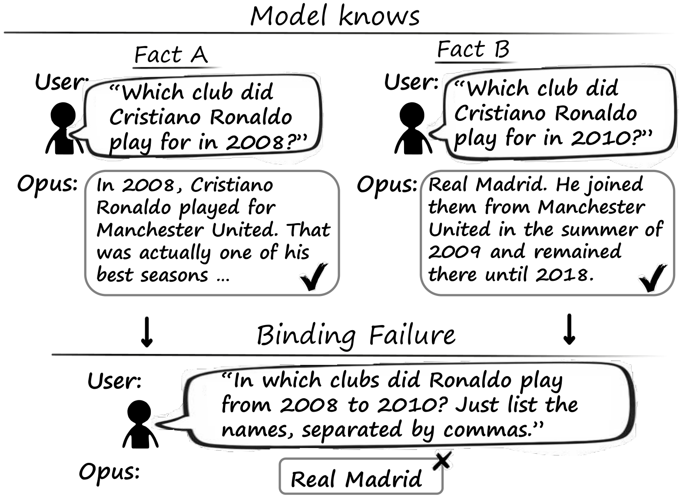
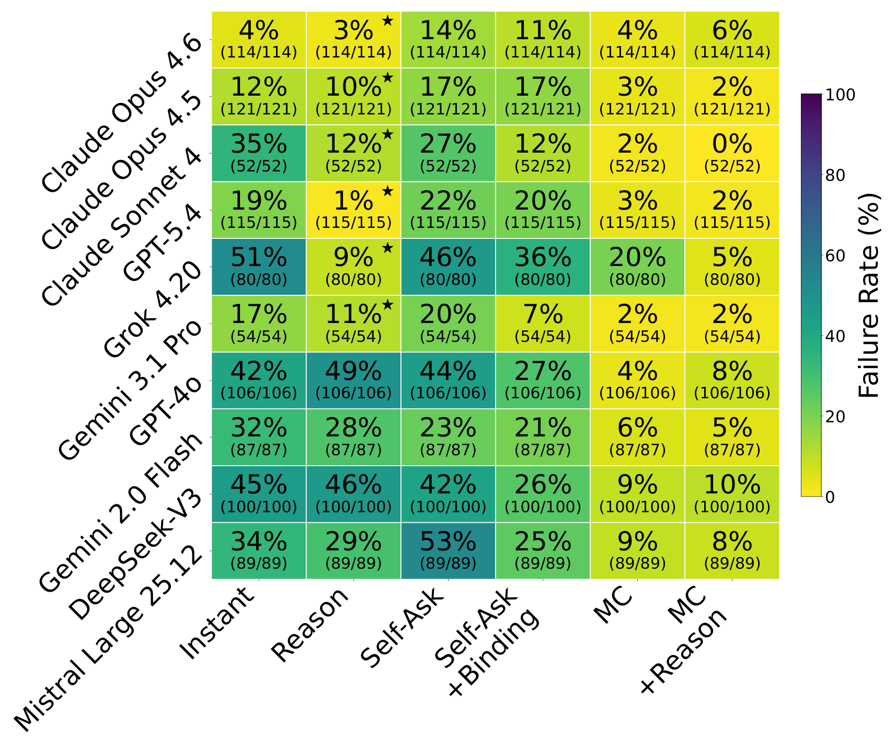
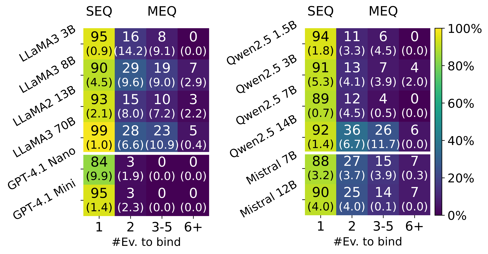
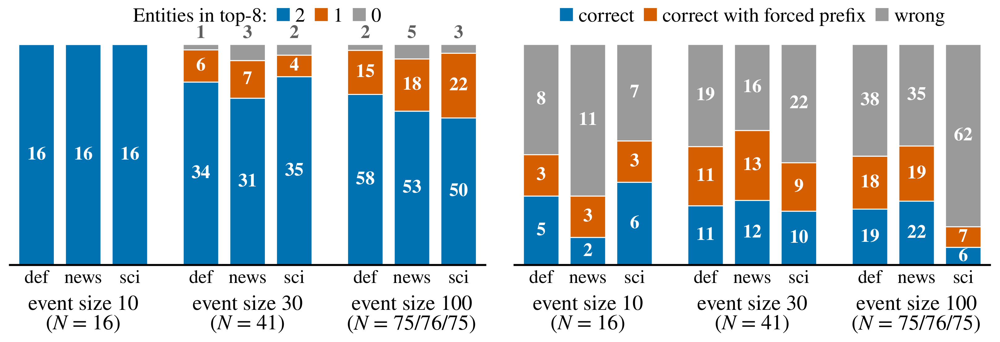
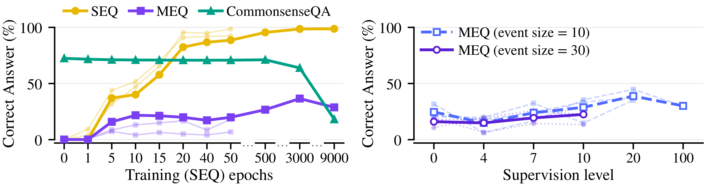
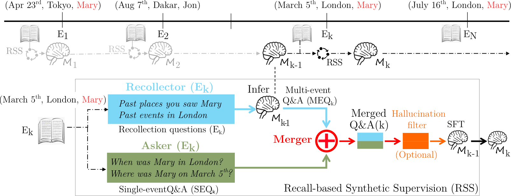
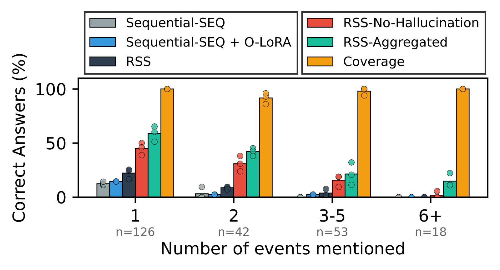

<div align="center">

# 🧠 Do LLMs Bind Episodes? 🔗

## Probing Cross-Episode Parametric Retrieval Through Shared Cues

Francesco Mantovani ⋅ Alberto Eusebio ⋅ Alexis Huet ⋅ Giulio Franzese ⋅ Pietro Michiardi ⋅ Dario Rossi ⋅ Zied Ben Houidi

**Accepted at NeurIPS 2026**

[](#) [](https://huggingface.co/datasets/FMantovani/do-llms-bind-episodes) [](LICENSE) [](https://neurips.cc/Conferences/2026)

#### A benchmark and controlled framework for measuring whether LLMs can retrieve all the episodes they know that share a common cue.



<sub><b>Figure 1.</b> Binding failure in Claude Opus 4.6. The model correctly answers questions about Ronaldo's career at each club separately (upper panels) but fails to integrate this knowledge when asked a binding question spanning both periods (lower panel).</sub>

</div>

When asked which clubs Ronaldo played for from 2008 to 2010, Claude Opus 4.6 answers Real Madrid, missing Manchester United, despite answering correctly when each period is queried separately. We study this **cross-episode binding** failure in frontier models and in controlled training:

- 🌍 **In vivo** (retrieval-based inference): frontier models (Claude, GPT, Gemini, DeepSeek, Grok, Mistral) fail to bind **4–51%** of episodes they verifiably know. Extended thinking reduces but does not eliminate failures; multiple-choice probing recovers most of them.
- 🧪 **In vitro** (standard remedies): scaling up to 70B, extended training and transfer learning each give partial progress, but none resolves binding. Correct answers often sit in the top logits yet fail to surface during generation.
- 🔁 **Integrative encoding** (RSS): recalling past episodes covers **92%** of evaluation queries once hallucinations are filtered, but under sequential training hallucination, forgetting and evolving supervision keep this from turning into accuracy.

We establish **episodic binding as an open problem in parametric memory**.

---

## 🔎 Problem definition

We formalize this failure as **cross-episode retrieval through a shared cue**. Let $\mathcal{M}$ be a model and $\mathcal{E}=\lbrace E_i\rbrace$ a set of learned episodes. For a retrieval cue $q$ (e.g., *"Ronaldo's clubs 2008–2010"* or *"All times Mary was in Tokyo"*), the ground-truth retrieval set is $Y(q) = \lbrace E_i : E_i \text{ matches } q\rbrace$ and the model's retrieval is $\hat{Y}(q) = \mathcal{M}(q)$.

- **Verified knowledge.** $\mathcal{M}$ *knows* $E_i$ if it retrieves it correctly for every cue that uniquely identifies it.
- **Binding failure.** $\mathcal{M}$ knows each episode in $Y(q)$ individually, yet fails to retrieve them jointly: $(Y(q)\cap \hat{Y}(q))\subsetneq Y(q)$.

This is not the Reversal Curse (both facts are retrieved in the forward direction, just not jointly), not the Compositionality Gap of multi-hop reasoning (no intermediate hop is required), and not catastrophic forgetting (the constituent facts are retained but jointly irretrievable).

Cognitive neuroscience proposes two mechanisms for cross-episode binding, which structure the paper:

| Lens | Mechanism | Where we study it |
|---|---|---|
| **Retrieval-based inference** | Episodes are stored separately and actively recombined at test time | *In vivo*: frontier models with extended thinking |
| **Integrative encoding** | A new overlapping experience reactivates the earlier trace, and both are encoded into a linked representation | *In vitro*: open-weight models we can train (RSS) |

---

## 🌍 In-vivo analysis of frontier models

We use a two-stage protocol: **(i) verify** that the model knows each individual fact, then **(ii) test binding** with a question that requires integrating them. The benchmark combines a filtered subset of [TempLAMA](https://github.com/google-research/language/tree/master/language/templama) (athletes and their clubs across years) with a newly curated dataset of public-event cases. Each instance has a shared cue, a ground-truth set of 2–4 temporally distinct episodes, single-episode verification questions and one multi-episode binding question.

A fact is **known** only if the model answers correctly in at least 3 of 5 trials for each of three verification question types (yes/no, forward recall, reverse recall). A binding question over known facts is a **failure** if at least 3 of 5 trials are incorrect. Responses are judged by Claude Haiku 4.5 (validated against two human annotators: Cohen's κ = 0.95 human–human, 0.76–0.77 human–judge).

<div align="center">

</div>

<sub><b>Figure 2.</b> Binding failures across frontier models, evaluated under different prompting strategies. Cells report the percentage of binding failures (incorrect answer in at least 3 of 5 trials) over each model's verified known facts and sample size (N = binding questions with verified facts). Models marked with ★ have extended thinking enabled.</sub>

**🎯 Key findings (600K+ API calls)**

- Under direct questioning (*Instant*), binding failures range from **4% (Claude Opus 4.6) to 51% (Grok 4.20)**. Most failures are incomplete answers rather than refusals; precision stays at 87–96%.
- **Extended thinking** generally reduces failures, sharply for models that fail often (Grok 4.20: 51% → 9%), little for those that already fail rarely.
- **Structured decomposition** helps when it targets binding: SelfAsk-Binding lowers failures for 7 of 10 models (DeepSeek-V3: 45% → 26%), whereas the original SelfAsk raises them for 6 of 10.
- **Multiple-choice** probing reduces failures for 9 of 10 models (GPT-4o: 42% → 4%), with no model above 20%: models *recognize* correct bindings even when they fail to *retrieve* them.

---

## 🧪 In-vitro analysis of open-weight models

Frontier models are black boxes that only let us *verify* existing knowledge. To ask under what conditions binding *can be induced*, we adapt the [episodic memory benchmark](https://github.com/ahstat/episodic-memory-benchmark) of Huet et al. (2025) into a controlled framework: *verification* becomes *learning*. We generate synthetic narratives of N ∈ {10, 30, 100} events in three universes (everyday events in New York, imaginary world news, sci-fi). Each event encodes a tuple (time, space, entity, content), e.g.

> *Episode 1. On **June 14, 2025**, at **Washington Square Park**, **Mila Gonzalez** captivated a small crowd. She eloquently explained **method acting techniques**, demonstrating with impromptu performances.*

| Question type | Example | Role |
|---|---|---|
| **SEQ**: single-event question, k = 1 | "What day did Mary paint in Tokyo?" | Training: ensures verified knowledge |
| **MEQ**: multi-event question, k > 1 | "When did Mary paint?" | Evaluation: tests binding |

An answer is correct only if recall equals 1 (all ground-truth items present); we report the **percentage of correct answers**, stratified by the number of events to bind k ∈ {1, 2, 3–5, 6+}.

### 📈 Does scale help?

<div align="center">

</div>

<sub><b>Figure 3.</b> Average correct answers percentage across three narrative types: everyday events in New York, imaginary world news, and sci-fi events. Each cell shows the mean across 3 sizes (10, 30, 100 events) and narrative universes, with standard deviation in parentheses (not all size–universe combinations were run for every model, due to GPU constraints).</sub>

All models achieve near-perfect single-event retrieval (84–99%) after SEQ training, without degrading CommonsenseQA. Larger models bind better (on k = 2, Llama improves from 16% at 3B to 28% at 70B), but the gap remains large: for k ≥ 6, even the best model (Mistral-12B) reaches only 7%.

### 🔬 Why are known facts omitted at generation?

<div align="center">

</div>

<sub><b>Figure 4.</b> Logit-lens analysis of Llama-3-8B on MEQ with k = 2. Left: MEQ with 2, 1 or 0 correct entities among the top-8 first tokens. Right: MEQ answered correctly, correctly only with the forced prefix, or wrongly.</sub>

The first tokens of both entities are usually among the top-8 next tokens, even when the final answer is wrong. Forcing the answer to start with the first token of the omitted entity turns **21.7% of all MEQ (86/397)** into correct answers: failures partly reflect token selection during generation rather than missing knowledge.

### ⏱️ Can extended training and transfer learning induce binding?

<div align="center">

</div>

<sub><b>Figure 5.</b> (Left) Extended training (Llama-3-8B, 100-event narratives): SEQ, MEQ and CommonsenseQA accuracy vs. epochs. (Right) Transfer learning (Mistral-7B): MEQ accuracy on a held-out narrative as the proportion of supervised (SEQ+MEQ) narratives increases.</sub>

- **Extended training.** MEQ accuracy rises from ~20% at 50 epochs to ~36.5% at 3000 epochs, while CommonsenseQA drops from 72% to 64%. Continuing to 9000 epochs does not sustain the gain: MEQ falls back to ~29% and CommonsenseQA collapses to ~18%.
- **Transfer learning.** With 9 supervised narratives out of 10, held-out MEQ improves to ~26% (from ~20%). Scaling supervision to 20 and then 100 narratives reaches ~39%, then falls back to ~30%. More supervision does not reliably teach binding.

---

## 🔁 Integrative encoding as a diagnostic protocol (RSS)

<div align="center">

</div>

<sub><b>Figure 6.</b> When a new event E<sub>k</sub> arrives, the <b>Recollector</b> queries the current model for related past episodes. The <b>Asker</b> generates single-event Q&As about E<sub>k</sub>. The <b>Merger</b> combines recalled episodes with the current event to synthesize multi-event Q&As, creating training data that connects the new fact to the existing episodic memory network.</sub>

Paralleling integrative encoding, **Recall-based Synthetic Supervision (RSS)** uses a frontier LLM as a teacher, while the *learner* model is both trained and queried for its parametric memory to build the supervision signal. An optional **Hallucination Filter** removes confabulated details by comparing the learner's recall to ground truth, separating binding failures from hallucinations. Unlike RAG or replay, RSS uses the model's own parametric memory as both storage and retrieval means.

<div align="center">

</div>

<sub><b>Figure 7.</b> Performance across conditions (left group: fully automated; right group: diagnostic controls using ground truth) as a function of the number of events k matching a question (30-event narratives, Llama-3-8B).</sub>

| Condition | What it isolates |
|---|---|
| Sequential-SEQ | Single-event Q&As only, no replay |
| Sequential-SEQ + O-LoRA | Orthogonal subspace constraints to mitigate forgetting |
| RSS | The full, fully automated protocol |
| RSS-No-Hallucination | Binding, with recall noise filtered out |
| RSS-Aggregated | Supervision quality, with sequential forgetting removed |
| Coverage | Upper bound: evaluation questions answerable from the generated supervision alone |

RSS nearly doubles SEQ performance over the sequential baseline and yields non-zero performance where the baseline fails. Without hallucinations, the union of generated questions **covers 92% of the MEQ evaluation**, yet training on it underperforms this upper bound. The remaining gap decomposes into three independent, well-studied obstacles: **hallucination**, **catastrophic forgetting** of earlier episodes, and **evolving supervision** (the same question has different answers as more events arrive).

---

## 🛠️ Reproducing the paper

The table maps every figure and table of the paper to the code that produces it. Paths are relative to `src/`.

| Paper | Content | Code |
|---|---|---|
| Fig. 2, Fig. 8 | In-vivo binding failures | `In_vivo_benchmark/experiments/run_binding_benchmark.py` → `In_vivo_benchmark/results/plot_fig2_and_appendix_heatmaps.ipynb` |
| Tab. 7, Tab. 9 | Threshold robustness, per-failure audit | `In_vivo_benchmark/results/table_threshold_sweep.py` |
| Tab. 8 | Failure rate by answer-set size | `In_vivo_benchmark/results/table_cardinality.py` |
| Tab. 10 | Refusal vs. incomplete failures | `In_vivo_benchmark/results/table_refusal_incomplete.py` |
| Tab. 11 | Precision, in vivo | `In_vivo_benchmark/results/table_precision.py` |
| Tab. 12 | Statistical significance | `In_vivo_benchmark/results/significance_bootstrap_ci.py` |
| App. B.3 | Athletes and Custom datasets | `data/benchmark/` (built with `In_vivo_benchmark/generation/`) |
| App. C | Synthetic narratives and Q&As | released in `data/narratives*/` (generator: `In_vitro_experiments/experiments/step_1_generation_little_book.ipynb`) |
| Tab. 2 | Dataset statistics, evaluated subset | `In_vitro_experiments/analysis/dataset_stats.py` |
| Fig. 3, Fig. 10 | Scale (Train SEQ), capacity verification (Train SEQ+MEQ) | `In_vitro_experiments/experiments/step_2_train_on_SEQ_and_MEQ.py` → `analysis/binding_heatmaps.py` (Fig. 3), `analysis/train_seq_meq.py` (Fig. 10) |
| Tab. 18 | Grid search (Sequential-SEQ) | `In_vitro_experiments/experiments/step_2_sequential_SEQ.py --grid` |
| Fig. 4, Fig. 11–13, Tab. 20 | Logit lens and forced prefix | `In_vitro_experiments/experiments/step_5_logit_lens.py` → `analysis/logit_lens.py` |
| Fig. 5 (left) | Extended training | `step_2_train_on_SEQ_and_MEQ.py --epochs N` → `analysis/grokking_transfer.py` |
| Fig. 5 (right), Fig. 14 | Transfer learning | `download_transfer_sets.py` → `step_2_trainsfer_learning_exp.py` → `analysis/grokking_transfer.py` |
| Fig. 9 | MEQ partial recall | `In_vitro_experiments/experiments/step_2_train_on_SEQ_and_MEQ.py` (writes the evaluation of each run) → `analysis/partial_recall.py` |
| Fig. 7 | RSS conditions | `In_vitro_experiments/experiments/step_2_RSS_pipeline.py` → `analysis/rss_conditions.py` |
| Fig. 15 | RSS ablations | `In_vitro_experiments/experiments/step_2_RSS_pipeline.py` → `step_3_load_results.ipynb` |
| Tab. 24 | RSS coverage | `In_vitro_experiments/analysis/coverage.py` |

### 🌍 In vivo

The benchmark (150 Athletes + 105 Custom items, questions and ground truth) is in [`data/benchmark/`](data/benchmark/).

```bash
# 1. Ask the models and judge the answers (calls OpenRouter; resumable; writes ./binding_failures_*/)
python src/In_vivo_benchmark/experiments/run_binding_benchmark.py --all-models -d all --temperature 0.3 \
    -v raw reason no_reason direct_hinted reason_hinted reason_firstletter \
       selfask selfask_modified_2 mc_raw mc_reason mc_no_reason
# 2. Figures and tables, from the same folder
jupyter notebook src/In_vivo_benchmark/results/plot_fig2_and_appendix_heatmaps.ipynb
python src/In_vivo_benchmark/results/table_threshold_sweep.py
```

Use `--model <name>` for a subset of models and `--judge-model` to change the judge (paper: Claude Haiku 4.5). To skip step 1, `python src/In_vivo_benchmark/results/download_invivo_outputs.py` fetches the raw outputs from [Hugging Face](https://huggingface.co/datasets/FMantovani/do-llms-bind-episodes). All analyses share one definition of a verified known fact, `results/binding_gate.py`; see [`src/In_vivo_benchmark/results/README.md`](src/In_vivo_benchmark/results/README.md).

### 🧪 In vitro

**How the narratives were made.** We started from the generator of the [Episodic Memory Benchmark](https://github.com/ahstat/episodic-memory-benchmark) with seed 99 and Claude 3.5 Sonnet. The transfer-learning experiment (Sec. 4.2.3) needs many more narratives, and by then Claude 3.5 Sonnet was deprecated, so these were generated with Claude Sonnet 4.6. The original raw materials (100 first names and their locations) are also too few for many narratives that must not share entities: [`raw_materials_extended.py`](src/In_vitro_experiments/generation/raw_materials_extended.py) extends them, and the prompt parameter `disjoint_book_id` gives each transfer narrative its own slice of names and locations and its own years. Without that parameter the generator behaves exactly like the original one (same events for the same seed). LLM-written text is not deterministic, so a regenerated narrative will not match word for word; the released narratives are the ones used in the paper.

**Transfer learning (Sec. 4.2.3, Fig. 5 right, Fig. 14).** A training set of size N holds N narratives: N−1 with single-event and multi-event questions (SEQ + MEQ), and one held-out narrative with SEQ only. After fine-tuning, the model is evaluated on the MEQs of the held-out narrative, i.e. on groupings of events it has memorized one by one but never seen grouped. N = 4, 7, 10 (10- and 30-event narratives) and 20, 100 (10-event narratives); each configuration has three folds, which share the same N narratives and hold out a different one (one per universe). The narratives are disjoint: each is generated with its own `disjoint_book_id`, i.e. its own slice of names and locations and its own years, so the held-out narrative shares no character, location or year with any training narrative (a model cannot answer its MEQs by recognizing entities seen in the training MEQs). All the narratives are in [`data/narratives_transfer/`](data/narratives_transfer/), and [`training_sets_books.json`](data/narratives_transfer/training_sets_books.json) lists the narratives and the held-out one of each training set. The training sets themselves (chat-format JSONL, ready for fine-tuning) are on [Hugging Face](https://huggingface.co/datasets/FMantovani/do-llms-bind-episodes) (`download_transfer_sets.py`). The number of chapters in a narrative's folder name can be below its number of events: events whose paragraph failed the generator's verification are left out.

The narratives (3 universes × 10/30/100 events, seed 99) are released in two versions, one per generator model: [`data/narratives/`](data/narratives/) (Claude 3.5 Sonnet: Llama, GPT-4.1, logit lens, RSS) and [`data/narratives_sonnet46/`](data/narratives_sonnet46/) (Claude Sonnet 4.6: Qwen, Mistral); all narratives are also on [Hugging Face](https://huggingface.co/datasets/FMantovani/do-llms-bind-episodes) (`invitro/`). Everything is loaded from there, so nothing is regenerated and no API key is needed to read them.

**Released outputs vs. re-running.** Tab. 2, Tab. 20, Tab. 24 and Fig. 4 are computed from released outputs (narratives, logit-lens outputs, RSS training set). Fig. 3, 5, 7, 10 and 14 are instead *re-drawn* from [`data/results/`](data/results/), which holds the scores reported in the paper, not the training runs behind them: these commands only show how each figure is made from its scores. To reproduce the experiments, train and evaluate the models yourself (GPU, commands below) and pass your own scores in the same format with `--scores`. Fig. 9 has no released scores and is plotted only from your own runs.

```bash
python src/In_vitro_experiments/analysis/dataset_stats.py        # Tab. 2 (from the narratives)
python src/In_vitro_experiments/analysis/binding_heatmaps.py     # Fig. 3 (paper scores; --scores for yours)
python src/In_vitro_experiments/analysis/logit_lens.py --plots   # Tab. 20, Fig. 4
python src/In_vitro_experiments/analysis/grokking_transfer.py    # Fig. 5, Fig. 14
python src/In_vitro_experiments/analysis/rss_conditions.py       # Fig. 7
python src/In_vitro_experiments/analysis/train_seq_meq.py        # Fig. 10
python src/In_vitro_experiments/analysis/coverage.py             # Tab. 24
```

Not every model was run on every universe and event size (GPU constraints; e.g. Llama3 70B and Mistral 12B), so some cells of Fig. 3 and 10 rest on fewer runs than others.

**Quick start: one training run.** Train(SEQ) of Llama-3-8B on the 10-event narrative of the default universe: one LoRA fine-tuning (Tab. 18 hyperparameters), then the evaluation of its answers. Needs one GPU, a Hugging Face token with access to the gated Llama weights, and a Google API key for the judge (`--judge` selects another judge model).

```bash
pip install -r requirements.txt
cp .env.example .env            # fill in GOOGLE_API_KEY and HF_TOKEN
python src/In_vitro_experiments/experiments/step_2_train_on_SEQ_and_MEQ.py \
    --model meta-llama/Meta-Llama-3-8B-Instruct --universe default --events 10 --policy single
```

Answers and verdicts are written to `data/narratives/Udefault_Sconcise_seed99/answers/`. The scores per number of events to bind are one entry of Fig. 3: compare with `LLaMA3 8B` → `10` → `default` in [`data/results/binding_heatmaps.json`](data/results/binding_heatmaps.json).

**Judge.** `--judge openrouter/<model id>` judges through OpenRouter. Without internet on the GPU node, train with `--skip-judge`, then judge the saved answers elsewhere:

```bash
python src/In_vitro_experiments/evaluation/judge_saved_answers.py --run <run folder with raw_answers/> --universe default --events 10
```

Fig. 3 runs were trained longer when needed (e.g. 80 epochs for Qwen2.5-1.5B, 10 events; `--epochs 80`).

**Plot your own runs.** `run_to_scores.py` turns run folders (each holding `evaluated_answers/`) into the binned scores of Fig. 3 (% of answers with recall = 1 on the evaluated set, per number of events to bind k = 1, 2, 3-5, 6+; mean ± std over the runs of the same model, universe and event size). It finds the narrative of each run by itself, prints the table and writes a `--scores` file:

```bash
python src/In_vitro_experiments/analysis/run_to_scores.py <run folder> [<run folder> ...] --label "LLaMA3 8B" --out my_scores.json
python src/In_vitro_experiments/analysis/binding_heatmaps.py --scores my_scores.json --out figures/   # figures/my_runs.pdf
```

Models of the paper (Hugging Face ids): `meta-llama/Llama-3.2-3B-Instruct`, `meta-llama/Meta-Llama-3-8B-Instruct`, `meta-llama/Llama-2-13b-chat-hf`, `meta-llama/Llama-3.3-70B-Instruct`, `Qwen/Qwen2.5-{1.5B,3B,7B,14B}-Instruct`, `mistralai/Mistral-7B-Instruct-v0.3`, `mistralai/Mistral-Nemo-Instruct-2407` (Mistral 12B).

Re-running the training (GPU; answers are judged by gemini-2.5-flash, key in `.env`):

```bash
# Fig. 3 (Train SEQ) and Fig. 10 (Train SEQ+MEQ): one model x universe, 10/30/100 events; hyperparameters
# (Tab. 18 for Llama) and narrative set chosen by model; --fft for full fine-tuning
python src/In_vitro_experiments/experiments/step_2_train_on_SEQ_and_MEQ.py --model meta-llama/Meta-Llama-3-8B-Instruct --universe default --policy single all
# Tab. 18: grid search on Sequential-SEQ
python src/In_vitro_experiments/experiments/step_2_sequential_SEQ.py --model meta-llama/Llama-3.2-3B-Instruct --events 10 --grid
# Fig. 4: logit lens / forced prefix on the adapter trained on SEQ
python src/In_vitro_experiments/experiments/step_5_logit_lens.py topk --universe default --events 30 --lora <adapter_dir>
# Fig. 5 right (TRAINING_FILE_PATH: one of the downloaded training sets) and Fig. 7
python src/In_vitro_experiments/download_transfer_sets.py
TRAINING_FILE_PATH=data/transfer_training_sets/10_chapter_books/training_sets_4/training_sets_4_fold1_default_heldout_default_9_seed_90.jsonl \
    python src/In_vitro_experiments/experiments/step_2_trainsfer_learning_exp.py
python src/In_vitro_experiments/experiments/step_2_RSS_pipeline.py
```

All RSS variants are selected through the `answering_params` dictionary of `step_2_RSS_pipeline.py`:

| Switch | Value | Paper |
|---|---|---|
| `recollecting_approach` | `"generic_qa"` | RSS-Simple (4 template-based queries, App. E.1.2) |
| | `"magic_12"` | RSS-Rich (12 handcrafted recall queries, App. E.1.2) |
| | `"prompt_with_context"` | RSS-Generated (LLM-generated queries, App. E.1.2) |
| `clean_recall_from_hall` | `True` / `False` | With / without the Hallucination Filter (App. E.1.4) |

All prompts (Asker, Recollector, Merger, Hallucination Filter) are defined in `In_vitro_experiments/generation/prompts.py`. The O-LoRA baseline uses [O-LoRA: Orthogonal Subspace Learning for Language Model Continual Learning](https://github.com/cmnfriend/O-LoRA) (Wang et al., 2023; official implementation).

---

## 📁 Repository structure

```
├── data/
│   ├── benchmark/              # In-vivo benchmark (Athletes, Custom)
│   ├── examples/               # One complete in-vivo example, explained in data/README.md
│   ├── narratives/             # In-vitro narratives, Claude 3.5 Sonnet (books, Q&As, generation cache)
│   ├── narratives_sonnet46/    # Same, Claude Sonnet 4.6 (Qwen, Mistral)
│   ├── narratives_transfer/    # Narratives of the transfer-learning training sets (see below)
│   └── results/                # Released in-vitro outputs (logit lens, Fig. 5 scores)
├── figures/                    # Paper figures (PDF), named by figure number
│   └── png/                    # PNG renders used in this README
├── src/
│   ├── In_vivo_benchmark/      # Sec. 3, App. B: frontier models
│   │   ├── generation/         # Athletes (TempLAMA) and Custom datasets
│   │   ├── experiments/        # Verification and binding evaluation
│   │   └── results/            # Fig. 2, Fig. 8, Tables 7–12
│   └── In_vitro_experiments/   # Sec. 4–5, App. C–E: open-weight models
│       ├── generation/         # Synthetic narratives, Q&As, RSS prompts
│       ├── evaluation/         # Prompting, fine-tuning, LLM-as-judge scoring
│       ├── narratives.py       # Loads the released narratives; evaluated-question set
│       ├── hyperparams.py      # Tab. 18 and per-family fine-tuning hyperparameters
│       ├── experiments/        # step_1 … step_5 pipelines and notebooks
│       ├── analysis/           # Tab. 2, 20, 24 and Fig. 4, 5 from released outputs
│       ├── models/             # Model wrappers
│       ├── io/                 # Data I/O
│       └── results/            # Aggregation utilities
├── docs/reproducibility.md     # Path and execution notes
├── accelerate_config.yaml      # Multi-GPU training config (70B, full fine-tuning)
├── .env.example                # API keys template
└── requirements.txt
```

---

## ⚙️ Setup

Python 3.12 (the paper's environment: Python 3.12.13; training ran with the CUDA 12.6 torch wheels, information only, not a requirement).

```bash
python3.12 -m venv .venv && source .venv/bin/activate
pip install -r requirements.txt
cp .env.example .env            # then fill in your API keys
```

CPU only (e.g. to try the code without a GPU): run `pip install torch==2.7.1 --index-url https://download.pytorch.org/whl/cpu` before `pip install -r requirements.txt`.

**Offline GPU nodes.** Download these where there is internet, copy them over, and set the same variables on the node:
- the model weights: `huggingface-cli download <model id>`, with the same `HF_HOME`, and `HF_HUB_OFFLINE=1` on the node;
- the tiktoken encoding used to count tokens when a narrative is loaded: `TIKTOKEN_CACHE_DIR=<dir> python -c "import tiktoken; tiktoken.get_encoding('cl100k_base')"`, then `TIKTOKEN_CACHE_DIR=<dir>` on the node;
- CommonsenseQA (the forgetting check) is downloaded on first use from [`tau/commonsense_qa`](https://huggingface.co/datasets/tau/commonsense_qa); offline, copy its three parquet files (`data/{train,validation,test}-00000-of-00001.parquet`) into `data/narratives/commonsense/` (and `data/narratives_sonnet46/commonsense/` for Qwen and Mistral).

Each training example is padded to `max_new_tokens` (4096 tokens), so a training step costs the same as a 4096-token sequence even for short answers.

The in-vivo benchmark calls the Anthropic, OpenAI, Google and OpenRouter APIs. The in-vitro experiments fine-tune open-weight models (Llama, Qwen, Mistral) with LoRA or full fine-tuning; the full set of experiments used 4k+ GPU hours.

---

## 📚 Datasets

**TempLAMA Athletes.** Athlete–team temporal facts from [TempLAMA](https://github.com/google-research/language/tree/master/language/templama), filtered for athletes with 2–3 teams and ranked by [Wikidata](https://www.wikidata.org/) sitelink count (top 150).

**Custom.** Real-world binding cases spanning political news, award announcements, business events, scientific missions, public appointments and other temporally grounded public events. Generated by frontier LLMs with web search across 20 thematic categories, then filtered for structural validity, factual accuracy and compliance with the binding definition: **105 of 564** candidates pass all filters.

**Benchmark files.** Both datasets are in [`data/benchmark/`](data/benchmark/), in the format described in [`data/README.md`](data/README.md).

**Raw in-vivo outputs.** All model responses and judge verdicts behind Fig. 2 and App. B.4 are released as a Hugging Face dataset, [FMantovani/do-llms-bind-episodes](https://huggingface.co/datasets/FMantovani/do-llms-bind-episodes) (folder `invivo/`: 142k trials, 59 MB), so every in-vivo table can be recomputed without re-running the API calls: `python src/In_vivo_benchmark/results/download_invivo_outputs.py` fetches and unpacks them.

One complete example (an item, all model answers and all judge verdicts), with a step-by-step explanation of the evaluation, is in [`data/`](data/README.md).

**Synthetic narratives.** Built with the [episodic memory benchmark](https://github.com/ahstat/episodic-memory-benchmark) generator (seed 99; Claude 3.5 Sonnet, and Claude Sonnet 4.6 for the Qwen/Mistral runs and transfer learning) and released in `data/narratives*/`. We thank its authors for permission to use and adapt it (see [Acknowledgements](#-acknowledgements)).

**CommonsenseQA.** The forgetting check during training uses [CommonsenseQA](https://huggingface.co/datasets/tau/commonsense_qa) (Talmor et al., NAACL 2019; MIT License), downloaded from Hugging Face and not redistributed here. Please cite it if you use this check (see [Acknowledgements](#-acknowledgements)).

---

## 📝 Citation

If you use this code or data, please cite:

```bibtex
@inproceedings{binding2026,
  title     = {Do {LLMs} Bind Episodes? Probing Cross-Episode Parametric Retrieval Through Shared Cues},
  author    = {Mantovani, Francesco and Eusebio, Alberto and Huet, Alexis and Franzese, Giulio and Michiardi, Pietro and Rossi, Dario and Ben Houidi, Zied},
  booktitle = {Advances in Neural Information Processing Systems (NeurIPS)},
  year      = {2026}
}
```

## 🙏 Acknowledgements

This work builds on the code and data of others. Please also cite them when you use the corresponding parts.

- **Episodic memory benchmark** ([ahstat/episodic-memory-benchmark](https://github.com/ahstat/episodic-memory-benchmark)): the synthetic-narrative generator and evaluation code that our in-vitro pipeline adapts. We thank its authors for permission to use and adapt it.
- **CommonsenseQA** ([tau/commonsense_qa](https://huggingface.co/datasets/tau/commonsense_qa), MIT License): the forgetting check during training. It is downloaded from Hugging Face and not redistributed here.
- **TempLAMA** ([google-research/language](https://github.com/google-research/language/tree/master/language/templama)) and [Wikidata](https://www.wikidata.org/): the source of the TempLAMA Athletes set.

```bibtex
@article{2025epmembench,
  title   = {Episodic Memories Generation and Evaluation Benchmark for Large Language Models},
  author  = {Huet, Alexis and Ben Houidi, Zied and Rossi, Dario},
  journal = {International Conference on Learning Representations},
  year    = {2025}
}

@inproceedings{talmor-etal-2019-commonsenseqa,
  title     = {{C}ommonsense{QA}: A Question Answering Challenge Targeting Commonsense Knowledge},
  author    = {Talmor, Alon and Herzig, Jonathan and Lourie, Nicholas and Berant, Jonathan},
  booktitle = {Proceedings of the 2019 Conference of the North {A}merican Chapter of the Association for Computational Linguistics: Human Language Technologies, Volume 1 (Long and Short Papers)},
  pages     = {4149--4158},
  year      = {2019},
  url       = {https://aclanthology.org/N19-1421}
}

@article{dhingra2022time,
  author  = {Dhingra, Bhuwan and Cole, Jeremy R. and Eisenschlos, Julian Martin and Gillick, Daniel and Eisenstein, Jacob and Cohen, William W.},
  title   = {Time-Aware Language Models as Temporal Knowledge Bases},
  journal = {Transactions of the Association for Computational Linguistics},
  volume  = {10},
  pages   = {257--273},
  year    = {2022},
  doi     = {10.1162/tacl_a_00459},
  url     = {https://doi.org/10.1162/tacl_a_00459}
}
```

## ⚖️ License

MIT. See [LICENSE](LICENSE).
